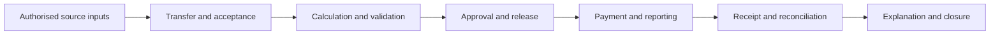

# Payroll response options and their trade-offs

29 October 2026. R03 internal analytical map, revised after the second challenge. Options can be combined. They are not a ranked shortlist, a compulsory sequence, evaluated products or demonstrated benefits in JGA's practitioner cohort. The [second-check readout](R03-SECOND-CHECK-READOUT.md) explains the refinements.

## Compare two dimensions

First identify what changes: process/control, configuration, data movement, decision support or core platform. Then identify who executes, authorises, checks and resolves the work: employer, shared team, provider, specialist or an external institution. A product name or an in-house/outsourced label does not supply either answer completely.

Read each row against an actual R02 need and context. The potential contribution is a hypothesis to test. Preserve functioning arrangements; consider the scale of change warranted by the gap rather than assume a new purchase.

| Response | When worth considering | Potential contribution to test | Conditions and work to assess | What remains to own or verify | Evidence hooks |
| --- | --- | --- | --- | --- | --- |
| P01 Retain the arrangement and improve a process/control | Required capability is adequate; source, cutoff, authority or exception ownership is unclear. No immediate purchase can also be reasonable if current outcomes are adequate or a prerequisite is unresolved. | Change the specific handoff without replacing functioning components. | An owner needs real authority/capacity; an instruction alone may not change behaviour or an external dependency. Reconsideration needs a reason and trigger. | Complete authorised inputs, actual control operation, consequence closure and a responsible review point. | CLM-0213–0215; R02 need/ownership evidence. |
| P02 Configure or extend current software/service | A required function exists but configuration, entitlement, permissions, training or scope is the gap. | Use existing capability for the relevant control/workflow. | Configuration and updates need testing; added modules/support can have limits or charges. Sample rules are a starting point, not a complete employer configuration. | Rules/effective dates, exceptions, appropriate roles, current package and reconciled output. | CLM-0216, CLM-0219–0221, CLM-0231. |
| P03 Add or change integration/reporting | Repeated transfer, mapping or a defined information gap is material. | Reduce a particular transfer task or provide useful timely information. | Agree source/blank semantics, IDs, periods, access, job/error monitoring and recovery. A connector can transfer incomplete/wrong data faithfully. | Source correctness/authority, partial acceptance, downstream reconciliation, actual decision use and external corrections. | CLM-0206–0213. |
| P04 Add analytical or AI assistance to a defined task | Exception investigation or information explanation has a bounded task and a credible review path. | Help locate, explain or work through a relevant issue. | Verify product/territory entitlement, source quality, permissions, test coverage, meaningful intervention and ongoing support. Review effort may offset time released. | Actual actions allowed, material decisions, output correctness, unresolved cases, update effects and result assessment. | CLM-0229–0234. No numerical savings or uniform adoption claim. |
| P05 Replace or modernise the core platform | An evaluated fit, lifecycle or foundation limitation remains; smaller changes may be insufficient. | Provide a different operating foundation or required capability. | Migration/IDs, configuration, interfaces, training, cutover, recovery and live workload need capacity. New modules may not yet deliver the intended information. | Useful pay/records/reporting, authorised release, stable support, retained expertise, defined change outputs/acceptance and evidence of the intended result. | CLM-0213, CLM-0223–0228, CLM-0245–0247. Case/scope context, not comparative vendor efficacy. |
| P06 Delegate defined bureau/managed execution | Specific recurring execution or cover requirements can be contracted clearly. | Access execution capacity or expertise under a defined arrangement. | Employer inputs, checking, approval, policy and oversight can remain. Processing, payment and employee-query duties require separate scope. | Actual entitlement, handoff acceptance, authorisation, bank/reporting result, escalation and closure. | CLM-0214, CLM-0216–0217, CLM-0219–0221. |
| P07 Combine retained and shared/provider components | One part of the cycle needs support while other work is appropriately retained. | Target a constraint without assuming wholesale delegation. | More interfaces can omit or duplicate tasks; shared definitions, authority, acceptance and recovery need owners. | End-to-end result across all components/partners, data access, actual engagement outputs, support boundaries, continuity and handback/exit. | CLM-0215–0217, CLM-0219–0221, CLM-0241, CLM-0245–0247. |
| P08 Strengthen expertise, operating cover or leadership | Absence, change work or an enduring/time-bound skill or authority gap is material. | Cover, develop or lead the relevant work while preserving operating knowledge. | Duration, tasks, access, competence/context, authority and quality review must fit. Individual capacity/advice, project delivery and ongoing execution have different obligations. | Defined tasks/work products, who judges completion, retained operations, quality, continuity, knowledge/ownership and handback where relevant. | CLM-0222, CLM-0245–0248 plus R02 capacity contexts. No inference of a shortage or need to hire. |

## Five conditions to assess across the relevant paths

| Condition | What to establish where relevant | Evidence hooks and limits |
| --- | --- | --- |
| Exact context and service unit | Product/module/package, country/entity, worker relationship, task, actual executor and included access/support. A global brand or country count is insufficient. | CLM-0241–0243. Employment-provider, HR-record, payroll and payment services are distinct; no new employment-advice path. |
| Who does the work | Originator, employee/manager approval, operator, beneficiary and support. Distinguish onboarding from recurring work; assess the result rather than assume net savings or burden. | CLM-0240, CLM-0243. Supplier self-service scope is not measured effort or user acceptance. |
| Continuing readiness | Applicable changes, responsible owner, relevant checks, communication and exception/recovery route. Separate transition, ordinary cycle, scheduled updates and exceptional changes. | CLM-0235–0239, CLM-0249, CLM-0251. Product-specific release cadence and public guidance are not universal schedules or private procurement mandates. |
| Engagement and output ownership | Individual capacity, enduring leadership, employer-directed work, consulting-led outputs or continuing service. Define work product, who judges completion, retained authority and knowledge handback. | CLM-0245–0248. Declared engagement models are not a signed payroll contract or demonstrated outcome. |
| Recovery, dependence and handback | Appropriate access, records/configuration/knowledge and an operable recovery/receiving route. Balance useful delegated capability against accepted dependence. | CLM-0250–0252. Export/backup is not a tested restored service; technical dependence is not automatically harmful or a measured switching cost. |

These are selective analytical checks, not a new compulsory questionnaire or security audit. A supported incumbent also needs continuing readiness; a new platform is not automatically better. No new path is added simply because a supplier uses a different commercial label.

## The handoffs behind the label

This is a simplified analytical flow, not a product workflow or mandatory order for every activity. Reporting/payment and other checks can run separately or repeat. An option can affect one or several handoffs. At each relevant boundary establish origin, destination, meaning/identity, timing, authority, acceptance, exception owner and recovery. An approved calculation, successful import, finalised run, statutory record and received payment are different states.

## Processing and payment are separate axes

The inspected Cintra documentation illustrates employer processing with employer/bank payment, employer processing with bureau BACS, bureau processing with employer/bank payment, and bureau processing with bureau payment. These are documented examples, not a measured market distribution. Organisational approval can exist outside an application banner. Exact current access/status behaviour is held because two dated articles differ. CLM-0217–0218.

## Evidence proportionate to the claimed result

| Claim being considered | Evidence to seek in the actual context | What is insufficient by itself |
| --- | --- | --- |
| Integration works | Relevant population/period accepted; partial/rejected cases resolved; downstream records/outcome reconciled. | Connection enabled, HTTP/job acknowledgement or a notification. |
| A control works | Defined relevant normal/exception cases, appropriate rules/roles, follow-through and known limits. | A template, alert, dashboard or vendor declaration. |
| AI assistance is useful | Task-relevant accuracy/quality, permitted actions/access, effective intervention, support and known review burden. | Feature availability, a fluent answer or a broad savings estimate. |
| Transition protects essential work | Relevant migration/cutover and recovery checks, owners, usable outputs and live-support arrangements. | Go-live date or another employer's accepted workaround. |
| Service delivery improved | Actual entitlement and measured/observed response, resolution and affected outcome over the relevant period. | Signed contract, response target or a new provider. |
| A business benefit occurred | Intended result, baseline where known, observed change, assessment period, remaining work and benefit owner. | Feature enabled, platform live, fewer staff assumed or capacity priced as a cash saving. |
| A change remains usable | Relevant update/configuration check, actual owner, user readiness, monitoring and workable recovery. | A successful historic test or an update installed. |
| Effort was reduced | The affected work across payroll, employees, managers, finance and provider; one-off versus recurring effort and result quality. | Fewer contacts handled by the central team alone. |

These are proposed evidence tests, not product tests performed or validated pass/fail thresholds. Relevant existing practitioner questions can establish what evidence was available and what remains unknown. R04/R05 will examine authority, investment conditions and full economics; R03 does not decide affordability, approve a business case or compute ROI.

## Counterevidence and limitations

Adequate incumbents, successful transition and positive scoped assurance remain in the map. A more comprehensive system can introduce new work; a smaller process response can be insufficient. Neither technology replacement nor doing nothing is presumed correct. The two implementation cases are selected public employers. Supplier documentation describes declared behaviour; official guidance supplies conditions, not market rates. Original practitioner integration and final publication checks remain open.

See the [desktop readout](R03-DESKTOP-READOUT.md) and detailed [integration](research-notes/r03/integration/INTEGRATION-TRADEOFFS.md), [delivery](research-notes/r03/delivery/DELIVERY-TRADEOFFS.md), [case](research-notes/r03/cases/CASE-EVIDENCE.md) and [automation/AI](research-notes/r03/root/AUTOMATION-AND-AI.md) memos. The canonical claim map is `08-qa/R03-record-map.json`.

The second challenge adds [historical/lifecycle](research-notes/r03-second-check/history/HISTORY-CHALLENGE.md), [market](research-notes/r03-second-check/market/MARKET-CHALLENGE.md), [competitor/prior-study](research-notes/r03-second-check/competitors/COMPETITOR-CHALLENGE.md) and [dependency/recovery](research-notes/r03-second-check/root/DEPENDENCY-AND-RECOVERY-CHALLENGE.md) checks. Its map is `08-qa/R03-second-check-record-map.json`. Constructed prior prompts are analyst contrasts; unaided participant priorities stay first.
