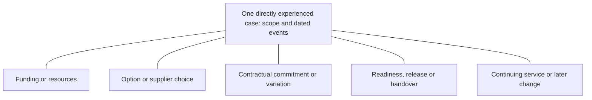

# R04 decision pathway: reconstruct the case

29 October 2026. Researcher-designed analytical structure supported by bounded published records. Not an observed universal workflow, approved final framework or expanded questionnaire. See the [evidence readout](R04-DESKTOP-READOUT.md).

## Start with the decision object

“The project was approved” is usually too broad for analysis. Identify what was authorised at that point: permission to investigate; an option/provider choice; funds or people; contractual commitment or variation; configuration or production release; operational acceptance; or a later service/change review. Preserve what the actual case calls it. Several decisions may belong to one case, and one act can cover more than one object.

Routine payroll/payment authorisation is a useful boundary example, not automatic evidence of investment authority. A small improvement may need no separate formal investment approval. A renewal may use existing authority or trigger further review; do not presume either route.

The branches are possible decision objects, not required gates or a prescribed order. For each relevant dated event record who acted, what authority or influence was established, the conditions and the actual disposition. Preserve iterations, parallel work and revised decisions rather than replacing the earlier record.

## Functions, actions and rights

These twelve functions are an analytical vocabulary. They are not twelve required posts, a responsibility assignment for the client or a ranking. A person/body can cover several; a function can be shared, unnecessary, undisclosed or disputed. Use role descriptions rather than personal names where sufficient.

| Function | Action to establish in the selected case | Inference to avoid |
| --- | --- | --- |
| F01 Need origin | Raised an operating problem or requested a review/change. | Initiator controls the eventual purchase. |
| F02 Requirements and evaluation | Defined requirements, examined alternatives or supplied relevant experience. | Evaluation participation is final selection authority. |
| F03 Sponsorship/change ownership | Carried the case, advocated it or resolved an escalation within a known remit. | Sponsor automatically owns budget or signature. |
| F04 Service and result ownership | Set or accepted service criteria; owned continuing operation, controls or intended results. | A payroll/HR/finance/IT title establishes ownership. |
| F05 Funding/resources | Allocated existing resources, approved additional funds/people or reprioritised within a described limit. | Budget approval means money was spent or a contract signed. |
| F06 Proposal/stage authorisation | Approved, declined, deferred or conditioned this defined proposal or stage. | Early permission remains unrestricted after scope/risk changes. |
| F07 Commercial process | Ran procurement, negotiation or commercial evaluation; identify any additional delegated right. | Running a tender means owning the business need or final vote. |
| F08 Contractual commitment | Was authorised to enter, vary or terminate the actual agreement. | Signatory was also the initiator, evaluator and budget holder. |
| F09 Specialist advice/assurance | Assessed risk, controls, privacy, legal, technology or readiness. Establish any condition/stop power separately. | A negative opinion itself proves a veto or spend authority. |
| F10 Delivery | Managed configuration, migration, integration, testing or transition. | Execution responsibility proves approval or supplier selection rights. |
| F11 Operational acceptance/release | Accepted a handover or authorised release/use within the described remit; distinguish ordinary payroll/payment controls. | Functional migration signoff equals full project go-live or investment approval. |
| F12 Escalation/exception | Resolved a limit, disputed condition or exception and made a specified decision. | Seniority alone proves escalation power. |

Evidence hooks: CLM-0253–0262 and CLM-0269–0277. Source-scoped governance definitions and selected cases support distinctions, not prevalence.

## Five selective conditions from the second challenge

| Condition | Establish where relevant | Boundary |
| --- | --- | --- |
| Effective remit and change | Requested/proposed scope, described delegation, effective period, vacancy/interim/succession or other change, and right actually exercised. | A role brief or unchanged title is not proof of an effective transfer of powers. CLM-0279–0282, CLM-0288–0289. |
| Organisation and contract level | Employer/external party, broad group/regional/entity/country level, service component and whose agreement/decision is involved. | No required corporate chart or legal-entity names; central/framework rights need not cover every local/customer contract. CLM-0279, CLM-0286–0287. |
| Mandate and practice | What the person understood should happen, what they directly observed or did, and any difference/change. | Reported practical control does not establish formal delegation, legal breach or motive. Preserve both accounts and knowledge bases. CLM-0285–0287. |
| Acceptance object | Hours for payment, output, handover, payroll result, readiness, supplier choice or contractual commitment. | Time/application approval does not automatically accept a project deliverable or authorise a purchase. CLM-0284, CLM-0290–0291. |
| Affected-party or external condition | What actually changes and whether relevant representation, agreement, specialist or external conditions were identified; owner, basis and state. | No universal employee veto, automatic processing consent or compulsory consultation route for every software change. Guidance is source-scoped, with final-use refresh needed. CLM-0292–0294. |

Apply these as analysis/clarification under existing questions, not five more mandatory questions. Obtain the unaided account first. Unknown, not applicable and limited direct involvement remain legitimate. See the [second-check readout](R04-SECOND-CHECK-READOUT.md) for source context and the six-firm/prior-prompt challenge.

## Minimum case and event record

A useful contribution needs a particular directly experienced decision, the contributor's involvement and an account of at least one action and what is unknown. Do not reject a valuable account because the person cannot reconstruct a full committee or disclose budget limits. The following fields organise analysis; use only relevant clarification under existing questions.

| Record | Capture | Handling rule |
| --- | --- | --- |
| Case context | Broad employer/country/service context, change/renewal type, originating need, direct involvement and selected event within the 24-month recall window. | Programme start can precede the selected recent milestone. Collect only necessary contextual detail and check identification risk. |
| Decision object | Scope of permission/choice/commitment; what was outside it. | Separate original purchase, later resources, configuration, release and ongoing review where relevant. |
| Event and date | Approximate date, as-of point, recommendation or action, and the function/body involved. | Approximate/unknown is valid. Publication date is not event date. Source date conflicts remain visible. |
| Authority and basis | Right claimed/exercised, domain and broad limit; first-hand action, directly observed, described mandate/process, participant understanding or unknown. | No confidential delegation document, contract, exact threshold or personal name required. Described formal authority is not independent documentary verification. |
| Influence | Input supplied, option changed, challenge or practical dependency and reported effect. | Record who attributes the effect; sequence alone does not prove causation. Attendance is not authority. |
| Condition | Concern/advice/prerequisite/binding condition/formal stop; who set it, who could clear/escalate it, whether resolved and next decision. | “Could stop” must specify what and how. Power believed available differs from a power actually exercised. |
| Disposition | Approved, declined, deferred, withdrawn/abandoned, pending, no formal approval required, not known or prefer not to disclose, preserving the guide's wording. Record conditional approval as approved with its conditions, not a replacement core response category. | Retaining an incumbent is an option/choice; it is not automatically a rejection or “no decision.” |
| Subsequent state | Contracted, implementing, released, operating, reassessed, or not established; intended/observed result separately. | Approval, signature, go-live and benefit are not synonyms. Record only the state actually known. |
| Source and permission | Locator/date, collection mode/guide version, knowledge limits, anonymisation and permitted use. | Published cases are separate from original JGA observations. No invented consent or client approval. |

Missingness is explicit: not asked, not known, not disclosed/prefer not to say, not applicable, not involved and disputed are different. Absence from a publication does not prove a function did not exist. Conflicting accounts retain their knowledge bases; do not resolve them by title or seniority. No numeric credibility/authority score is created.

## Read the evidence according to its purpose

- A delegation or terms of reference can define powers/limits; it does not by itself establish what happened.
- A dated resolution can establish the recorded decision/conditions; it does not prove subsequent execution or benefit.
- A contract or notice must be read in its applicable regime and wording. Selection, intention to contract, award, entry, acceptance and release are distinct possibilities. CLM-0278.
- Assurance establishes the assessor's scoped view or recommendation, unless a separate decision right is demonstrated. It does not automatically approve funds or release.
- Employer/supplier/adviser narratives establish attributed accounts, with source-interest and missing roles retained. They are not independent verification or market prevalence.
- Practitioner input can establish direct experience and understanding. Do not present unprovided private documents or others' motives as verified.

## How this fits the unchanged instrument

| Existing core | Selective analytical use |
| --- | --- |
| Q001 | Establish actual contribution and distinguish implementing, evaluating, recommending and approving. |
| Q006–Q008 | Anchor the recent case, scope, disposition and trigger. Use intended routes only when no actual event exists, with correct status. |
| Q009 | Establish authority for the specific object, basis, remit and conditions rather than list senior titles. |
| Q010–Q011 | Separate requested evidence from evidence reportedly influencing a particular event; R05 will deepen its substance. |
| Q012–Q013 | Preserve alternatives, legitimate retention, constraints, escalation and conditional approval. |

No core wording or client document is changed by this map. Do not read the whole function list to everyone or lead a person toward a presumed CFO/IT veto. Obtain the unaided account first and clarify relevant gaps only. No original practitioner record has yet been created.

## Downstream use

For R05, connect evidence and resources to the appropriate object and authority, including recurring and implementation resources where they actually differ. For R06, preserve the dated outcome and later change in state. For R08, publish a proportionate decision aid supported by actual cases and explicit exceptions. Do not convert this internal design into a tested framework, legal instruction or mandatory corporate process.

The machine-readable [map](R04-decision-map.json) defines vocabulary, five selective conditions and a blank record template. First-pass published examples and second-check examples retain their source type and unknown rights; its participant observation collection is empty. Constructed prior prompts are analyst contrasts only and do not supply authority or demand evidence.
