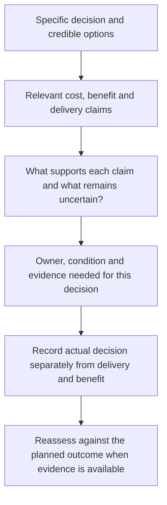

# R05 business-case evidence checklist

29 October 2026. Researcher-designed analysis aid, supported by inspected guidance, supplier declarations and bounded published cases. Not a validated scoring model, employer forecast, legal instruction or mandatory questionnaire. See the [desktop findings](R05-DESKTOP-READOUT.md).

## Start with the next specific decision

Use R04's decision object, effective remit and actual context. Permission to explore an option can legitimately use assumptions that need stronger evidence before contract commitment, migration release or service acceptance. Establish which uncertainty matters now, who owns resolving it and when a further decision is needed. Do not assume every configuration change requires a full procurement programme.

The nine domains below overlap and should not be totalled into a score. Apply relevant rows only; unknown, not asked, not applicable and prefer not to disclose remain valid. A useful contribution does not require a complete business case or confidential document disclosure.

| Domain | Evidence worth establishing in the case | What does not prove it | Linked claims |
| --- | --- | --- | --- |
| E01 Choice and counterfactual | Actual need, decision, scope, minimum required result, credible baseline and feasible alternatives, including retention/improvement where appropriate. | A preferred product, frozen zero-cost BAU or an assumed legal requirement. Baseline comparison is not automatically a feasible recommendation. | CLM-0295–0297, CLM-0302. |
| E02 Resource and cost boundary | Whole-life scope; existing and additional work; service/volume unit; transition, recurring and exit costs; included/excluded/unknown items. | A headline rate, bundle allocation or no new invoice. Existing expertise/time can be constrained; avoid counting unchanged allocations as new cash. | CLM-0296, CLM-0300, CLM-0303–0308. |
| E03 Benefit and realisation | Benefit type/status, baseline, mechanism, owner, adoption/dependencies, relevant target/period, quality and overlapping claims. | Enabled feature, minutes multiplied by salary, forecast approval or the same capacity counted several ways. | CLM-0298–0302, CLM-0319–0320. |
| E04 Financial view and affordability | Resource/TCO, incremental cash and funding profile reconciled; time horizon, price/currency basis, metric definition and actual decision remit. | A positive forecast ratio as available cash, a social discount rate as corporate policy or faster payback as whole-life superiority. | CLM-0295–0302. |
| E05 Uncertainty and material conditions | Important assumptions, credible ranges/scenarios when supported, unmonetised outcomes, dependency/risk owner, mitigation evidence, interactions and residual condition. | Invented likelihood/fines, generic optimism factor, unexplained risk colour or a precise single forecast. | CLM-0297, CLM-0313–0314, CLM-0318. |
| E06 Operating and change capacity | Who maintains reliable payroll while change occurs; protected time, expertise, cover, practical learning and sustainable support/handover. | Allocated funds, available training, attendance or a named team as proof of usable capacity. A permanent full project team or hire is not automatically needed. | CLM-0310–0312, CLM-0315–0318. |
| E07 Readiness and continuity | Relevant data/mapping/reconciliation, integration and exception checks; executed results, remaining items, contingency/recovery and scoped acceptance. | Planned tests, a completed template, demonstration, upload, calendar date or go-live as universal accuracy or realised benefit. | CLM-0309–0310, CLM-0315–0318. |
| E08 Commercial and lifecycle obligations | Actual entitlement, processing/payment/support roles, quantities, price basis/date, transition overlap, renewal/change/exit and receiving-service readiness. | Promotion, empty calculator, unspecified guarantee, export alone or assumption that every provider includes/charges the same work. | CLM-0303–0308. |
| E09 Measurement and evidence use | Claim/provenance/status, actual context, baseline and assessment owner/period; what evidence was requested/supplied and reportedly influenced the decision. For AI, task-quality/review effort and deployment context. | Outcome monitoring as causal attribution, pilot evidence as universal scale proof, supplier declaration as independent validation or evidence requested as automatically influential. | CLM-0299, CLM-0319–0322. |

## Keep cost and benefit states explicit

These are analyst labels, not a numerical evidence ladder. Several can apply to one record and one does not automatically become the next.

| Record family | Examples of states to distinguish |
| --- | --- |
| Cost/commitment | Public declaration; actual quote; budget/forecast; contractual commitment; invoice/payment; forecast-to-complete; unestablished. |
| Benefit | Desired capability; forecast effect; approved plan; capability enabled; reported observed result; assessed contribution; evidenced cash effect; unestablished. |
| Readiness | Proposed plan; work underway; executed result; unresolved exception with owner; accepted residual condition; unestablished/not applicable. |
| Source/knowledge | Public guidance; supplier/adviser account; directly experienced action; participant understanding; inspected document; independently evaluated result within its stated scope. |

A forecast may be useful without being observed; an executed test may be useful without proving a business benefit. A publicly reported positive result is not an independently inspected audit. The relevant basis and limit must accompany the record. No percentage completion, evidence-strength score or pass/fail threshold is created.

## A minimum analytical line

For a decision-critical item record: **claim → option/decision → basis and status → conditions/uncertainty → owner → when/how assessed → reported effect on the decision**. Keep the cost/resource view, amount/unit/period and provenance where they exist. Do not populate missing values from industry anecdotes.

Useful optional clarification under the unchanged core:

- Q008: intended result, originating problem and actual required outcome.
- Q009: relevant decision/benefit/resource owner and effective authority, using R04.
- Q010: requested baseline/cost/benefit/readiness evidence and what was actually available.
- Q011: evidence reported as influential, by whom and on what basis; do not infer causation from sequence.
- Q012: alternatives and credible retention/do-minimum route.
- Q013: conditions, unresolved assumptions, capacity and assessment of subsequent results where known.

Do not read this whole table as another questionnaire. Obtain the unaided case, use relevant clarification and preserve limited knowledge or non-disclosure. No additional compulsory questions, respondent cohort, employer workbook or document-collection requirement is introduced.

## A proportionate route through the evidence

This depicts analysis, not a compulsory organisational approval sequence. Options, conditions and timing can change; evaluation need not wait until the end. Use a simpler record for a small delegated decision. R06 will later examine the actual outcome and explanation; this checklist does not predict approval or decline.

## Boundaries worth retaining in the finished publication

- Public social appraisal, educational financial metrics, supplier declarations, forecasts and actual case evidence are different inputs.
- Necessary control/quality/continuity outcomes can remain material without artificial monetary values. Feasibility and the requirement's applicability must be established.
- Support, review work and realisation conditions belong beside time savings. Operating work cannot simply disappear from a proposal.
- Unknown is not zero, a promise is not a quote and an account credit is not automatically cash reimbursement.
- No private employer's return, liability, budget, discount rate or acceptable risk was calculated or approved in this desktop work.

The [structured map](R05-evidence-map.json) carries the nine domains, state vocabularies and a blank template. Its participant observations, forecasts and calculations remain empty. The Table's separately commissioned financial model is not populated by this worksheet.

## Selective conditions from the second challenge

Apply these within the existing nine domains, only where relevant. They are not new required questions, mandatory gates or scores. The [second-challenge readout](R05-SECOND-CHECK-READOUT.md) carries the evidence and source-specific limits.

| Condition | Clarify for the actual case | Avoid inferring |
| --- | --- | --- |
| C01 Dated case and boundary | Current version, payroll component/wider programme, changed inputs and next reconsideration point. | A historical approval proves current readiness/value, or every change requires full reapproval. CLM-0324–0327, CLM-0340. |
| C02 Distribution and funding | Who bears money/work/risk, who benefits and when, actual allocation/shortfall and funding remit. | Aggregate value establishes every party's affordability, or a conflict/transfer must exist. CLM-0324, CLM-0326, CLM-0328. |
| C03 Service unit and lifecycle cash | Actual contract/version and licence/payroll/payslip/employee/payment unit, retained work, use/commitment/access/handback dates and funding changes. | Active headcount is universal, stopping use ends charging, or ordinary wage principal equals additional transformation cost. CLM-0329–0336, CLM-0341. |
| C04 Usable capacity | Required skill and time window, existing paid availability, extra cover and displaced work. | Annual hours are interchangeable, salary allocation means extra cash, or released time requires a new hire or staffing cut. CLM-0323, CLM-0342–0343. |
| C05 Evidence and benchmark fit | Edition, underlying period, role/remit, geography, pay/engagement basis, contributing population and actual assignment evidence. | Salary guide is loaded employer cost, service marketing proves availability/benefit, or prompted verification advice establishes buyer demand. CLM-0337–0341; prior-study bridge. |

Keep ordinary wages, supplier fees and changed timing of funding distinct; unknown is not zero. No public tariff, salary, standard loading, tax-status rule, financial forecast or compulsory review method has been adopted. Payfit/Modulr version/quantity limits and earlier holds remain explicit. The core instrument and client files are unchanged.
