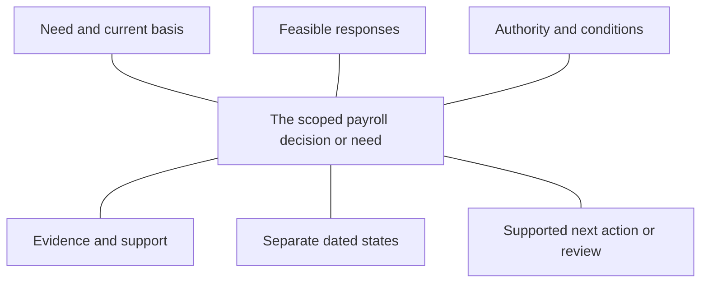

# Payroll Investment Decision Framework

R08 working version0.2,29October2026. Preparatory desktop draft; independent integrated review passed. An original arrangement of this project's evidence, not a validated predictor, fixed workflow or recipe for approval. Final practitioner integration and client review remain open.

## Use one concrete decision, not a general technology theme

Start wherever the account begins: an operating need, a renewal, an approved phase, a stalled change or a reason to retain what works. Specify the relevant work and the date/remit only where known. Keep the contributor's unaided account before examples. This canvas helps organise that account; it is not six extra compulsory interview questions.

The aim is a clearer decision brief: what is known, what it is based on, what remains unestablished and any next action or review the account supports. All views are optional. A useful partial brief can leave an owner, date, approval position or next action unknown. Do not demand a confidential business case to fill a box.

## Six linked views

| View | Use it to establish | Keep separate |
| --- | --- | --- |
| V01: What needs attention, if anything? | Describe the actual task, what works, who is affected and the intended outcome. | A need is not a chosen solution. Adequate service and no new priority are valid. |
| V02: Which responses are feasible? | Consider the relevant responses feasible at the specified decision/event date; distinguish knowledge available then from a later retrospective account. Include current capability, process/skills, retention or scoped change. | Options can combine; advertised availability does not prove usable access. Do not force a purchase or shortlist. |
| V03: Who can decide what? | Establish the authority, resource responsibility or external condition for this particular action, object and date, where known. | Seniority, sponsorship, funding, signature and release rights differ. No separate formal approval can be a valid scoped position. |
| V04: What evidence and support are relevant? | Match the outcome to the evidence actually requested or supplied, known resources, affordability and practical delivery conditions. | Requested, supplied, accepted, believed influential and independently corroborated evidence are different claims. Acceptance does not verify every assertion or establish causal influence. Existing resources can support work without a new budget. |
| V05: What is the evidenced position? | Keep the proposal decision, commitment, implementation and intended/assessed benefit separate, with their own scope and dates where supplied. | Approval is not operation or benefit. Last evidenced state is not automatically the current or ultimate outcome. |
| V06: What next action or review is justified? | Identify a remaining evidence need, actual condition or relevant review only when supported by the account. | A proposed remedy is not a proven effect. Retention, a reasoned stop, no new action or an unresolved partial brief can be legitimate. |

The numbers identify views, not steps or a maturity score. Use only the parts relevant to the actual task. New evidence can lead back to an earlier view or change the explanation. The same arrangement can retain one component, change another and stop a third.

The table is the complete text equivalent of this editable diagram. Connections show related views; they do not prescribe a progression.

## Make a useful brief with the facts available

Use this sentence structure only as a writing aid, leaving out unsupported parts:

“For [specific work/remit], the account reports [scoped facts] / the available evidence supports [specific claim] on [source/date if known]. It does not yet establish [material gap]. [Supported action or review, if any] concerns [relevant function or condition, if known].”

This is a blank writing pattern, not a quotation or an employer observation. A next step is not required where none is known or appropriate. An adequate current arrangement, continuing work, a legitimate renewal or stop and a pre-proposal need all fit without inventing a purchase. Never-raised need is not automatically pending/declined; continuing operation is not automatically a deliberate renewal.

## Use evidence for the claim it can support

Ask what was requested, what was actually supplied, what the contributor believes influenced assessment and the basis for that belief. Those are different claims. A change after evidence was supplied is not, by itself, a causal demonstration. Independently established effects should be claimed only if their evidence exists; this project does not require a causal experiment or confidential approval records.

For resources and value, distinguish whole-life work/resources, future incremental cash and funding affordability. Preserve non-cash outcomes such as continuity or usable capacity without converting every benefit into money. Planned, approved and spent are different; paid hours are not necessarily available expertise. A tariff, salary guide or supplier promise is not a customer-specific total cost or benefit.

For position, keep decision, commitment, implementation and benefit in separate fields. A release condition can remain after funding; a rollout postponement does not itself change an earlier investment decision. Attach each statement to the component/task it describes. A future policy phase, software roadmap or passed target date does not establish delivery.

## Select detail only when it changes the explanation

The existing R02–R07 maps provide depth behind the canvas: need/consequence, eight combinable response paths, action-specific decision rights, three financial views and nine evidence domains, outcome-specific events, and priority/context conditions. They are analytical aids, not cumulative checklists to read to every contributor.

Relevant context can include retained work, actual account/access, worker/service arrangements, jurisdiction, available skill/time, a dependency beside business-as-usual or whose task improves. Do not infer it from company size, a role title, headquarters, a public feature list or the fact that a scenario asked for a hire. Preserve not known, not measured, not applicable and not disclosed separately; do not score missingness or infer failure.

## How the draft was challenged

Fifteen expressly constructed walkthroughs apply this canvas to adequate service, pre-proposal need, scoped action without separate formal approval, conditional phases, rational renewal, a changed route on a retained platform, delayed rollout, component stop, uncertain capability access and limited knowledge/disclosure. They demonstrate how the design handles supplied premises. They are not real practitioner cases, user testing, market validation or proof that the framework improves decisions.

## Evidence and next integration

Each view links to existing findings, source-specific claims and unchanged question IDs in the [structured framework](R08-framework-map.json). The [evidence synthesis](research-notes/r08/evidence/EVIDENCE-SYNTHESIS.md) preserves collisions, hypotheses and held claims. The [report integration plan](R08-REPORT-INTEGRATION.md) maps the two proposed parts and conclusion.

No numeric score, adoption/priority ranking, employer forecast or new interview question is created. Source, client, rights and practitioner gates remain. Final Word/PDF, editable graphic and chart/data deliverables are not replaced by these working files. Nothing sent.

## Second challenge: qualify the claim, not just the decision status

The five conditions below add depth only where material. They introduce no new view, question, score or documentary requirement. Existing blank canvas fields remain unchanged; an optional blank evidence-qualification note is available in the structured map. A direct account can remain useful without independent corroboration, provided the basis and limits are clear.

| Selective condition | When it changes the explanation | Boundary |
| --- | --- | --- |
| Event-time basis and later interpretation | Where history changes the explanation, distinguish the selected event date and knowledge/options available then from the date, perspective and basis of a later account. | No hindsight optimality, reconstructed contemporaneous knowledge, universal release-risk threshold or observed later outcome from an old target. CLM-0429, CLM-0430, CLM-0431, CLM-0432. |
| Approval object and recurring operating period | Where an approval or handoff matters, identify whether it concerns the investment/change, a release, one report/task/payroll run or payment authorisation; retain the actual period and continuing duties if known. | One accepted report does not prove payment, a completed investment, future-period readiness or transfer of every duty. No exact universal UI/workflow, legal determination or monitoring obligation. CLM-0433, CLM-0434, CLM-0436. |
| Evidence object and case-specific match | For material evidence identify the claim about the work, provider/team/person, engagement, date and remit that it actually supports, and what remains unverified or introduced as an assumption. | A firm case, process description, placement list, salary guide or model recommendation is not current candidate fit/availability, acceptance/start, an executed engagement or the later payroll result. CLM-0437, CLM-0438, CLM-0439, CLM-0440, CLM-0441. |
| Qualification beyond acceptance | Selectively retain source/status, task/object, date/version and knowledge basis, then describe what supports the material claim and the limits of any corroboration. | Accepted is not independently verified; repeated links or models may share a source. No automatic source-type ranking, confidence score, required document or assumption uncorroborated means false. CLM-0442, CLM-0443, CLM-0444. |
| Divergent accounts and alternative explanations | When accounts materially differ, inspect whether object, time or assessment criterion differs. Preserve a remaining disagreement and plausible alternatives rather than force consensus. | Do not invent a dispute, average incompatible accounts or require recontact. Existing disclosure, permission, burden and actual knowledge limits apply. CLM-0443, CLM-0445. |

In particular, separate the decision date from the later account date; change approval from a recurring run/report/payment action; and evidence about a firm from evidence about a particular person, engagement or outcome. Keep any introduced assumption identifiable. Acceptance of a report is not automatic verification or causal proof. If accounts differ, inspect their scope/time/criterion and retain unresolved differences rather than manufacture consensus.

[Second-challenge findings](R08-SECOND-CHECK-READOUT.md) give the original-source checks, six-comparator/JGA distinctions, earlier-study premises and additional constructed routes. Independent integrated preparatory second-challenge review passed. The first-pass review remains an as-of record for version0.1, preserved in snapshots. Nothing sent.
